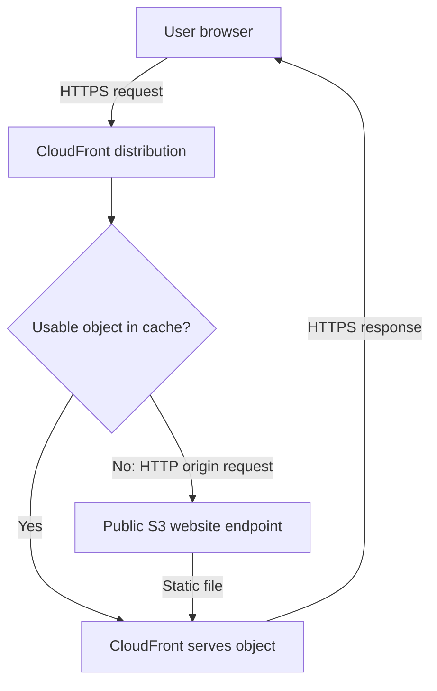

# AWS Static Website Deployment: S3 and CloudFront

**Alvira Rahman | Amazon S3, CloudFront, Bucket Policies, HTTP/HTTPS**

I deployed a SpaceX-style static homepage on Amazon S3, connected it to CloudFront, and investigated access and origin-connection errors. This repository brings together the source files, screenshots, and troubleshooting record from my first AWS project.

## Start Here

- [Troubleshooting case study](docs/Troubleshooting.md) — three incidents, investigation steps, policy example, architecture diagram, and troubleshooting flowchart.
- [Screenshot evidence](screenshots/) — seven captures from the deployment and troubleshooting work.
- [Homepage source](index.html) — the HTML entry point, with styles, scripts, and images in the accompanying folders.

## Captured Deployment Result

This screenshot records a successful homepage load during the lab. Current availability and recovery after the later object-deletion incident have not been verified.

## What I Deployed

- Static HTML, CSS, JavaScript, and image assets stored in S3.
- S3 static website hosting with public-read object access in the original design.
- A CloudFront distribution using the S3 website endpoint as its origin.
- An HTTP-only origin connection matching the website endpoint's supported protocol.
- HTTPS delivery to the browser, as recorded in my lab notes.

## Architecture

CloudFront checks its cache and retrieves content from the origin when needed. The S3 website endpoint uses HTTP; the browser-to-CloudFront connection is a separate HTTPS connection.

| Component | Documented configuration |
|---|---|
| S3 bucket | `spacex-clone-alvira` |
| S3 Region | `us-east-1` |
| Origin type | S3 static website endpoint |
| Origin connection | HTTP, port 80 |
| Original access model | Public-read website objects |
| Origin Access Control | Planned improvement; not implemented in this version |

## Troubleshooting Highlights

| Incident | Investigation and action | Recorded result |
|---|---|---|
| 403 Forbidden | Reviewed public-access settings and the bucket policy; recorded changes allowing website-object reads. | Resolution recorded in lab notes; original permission-setting screenshots are unavailable. |
| 504 Gateway Timeout | Checked the origin type and configured HTTP only to match the S3 website endpoint. | Screenshots show the error, corrected setting, and homepage loading. |
| Object deletion during another lab | Documented 15 objects deleted and the lesson about testing with the intended IAM identity. | Deletion is captured; recovery after deletion is not documented. |

[Read the complete troubleshooting case study](docs/Troubleshooting.md).

## Skills Demonstrated

S3 website hosting; bucket policies; Block Public Access; CloudFront origin configuration; HTTP/HTTPS troubleshooting; investigation of access and connectivity errors; technical documentation supported by screenshots.

## What I Learned

I learned to compare the actual origin configuration with the endpoint's supported protocol, distinguish viewer access from origin access, and verify outcomes after making changes. I also learned to document security trade-offs and distinguish screenshot evidence from findings recorded only in notes.

## Planned Improvements

- Migrate to an S3 REST origin with CloudFront Origin Access Control, remove public-read access, and enable Block Public Access.
- Enable S3 Versioning and document a controlled recovery test.
- Use separate test resources and the intended non-root identity for permission testing.

These improvements are planned and are not presented as completed work.

## Scope and Attribution

The demonstrated scope is static homepage hosting and the recorded AWS troubleshooting. Additional navigation pages and backend functionality are outside the demonstrated scope.

This is an educational SpaceX-style project, unaffiliated with SpaceX. Branding and imagery belong to their respective owners.

## Repository Contents

| Path | Contents |
|---|---|
| `README.md` | Project overview, architecture, and troubleshooting highlights |
| `docs/` | Troubleshooting case study and project documentation |
| `screenshots/` | Seven evidence images and accompanying documentation |
| `index.html` | Homepage source |
| `error.html` | Error-page source file |
| `css/` | Website styles |
| `js/` | Website JavaScript |
| `img/` | Website image assets |
