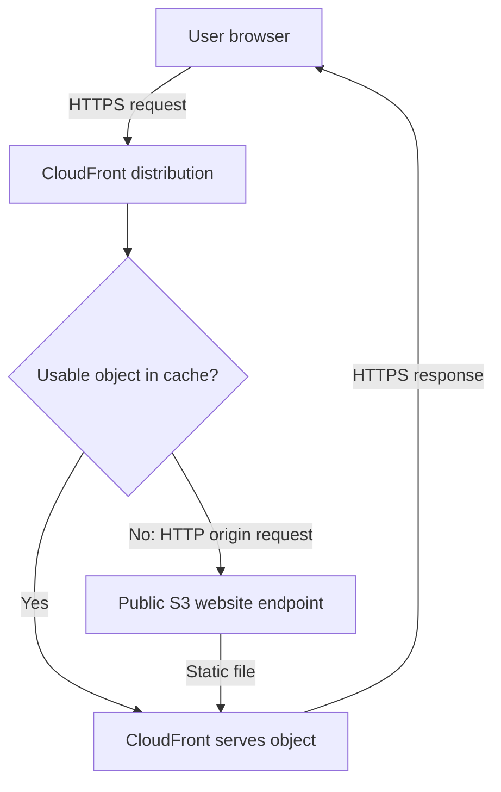
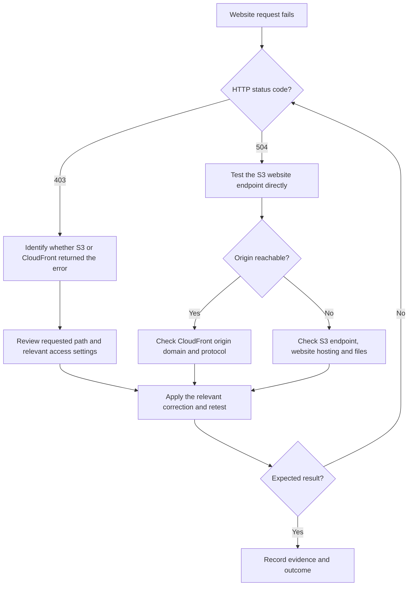

# Troubleshooting Case Study: Static Website on S3 and CloudFront

**Author:** Alvira Rahman  
**Project:** SpaceX-style static homepage deployment  
**Services:** Amazon S3, Amazon CloudFront, S3 bucket policies  
**Region:** us-east-1  
**Lab dates recorded in my notes:** April 21-22, 2026

[Project overview](../README.md) | [Screenshot evidence](../screenshots/)

## 1. Summary

| Item | Detail |
|---|---|
| Goal | Host a static homepage in S3 and deliver it through CloudFront. |
| Incidents | 403 Forbidden, 504 Gateway Timeout, and object deletion during another lab. |
| Recorded diagnoses | Public-access configuration for the 403; an origin protocol mismatch for the 504. |
| Captured result | The homepage loaded at the CloudFront address during the lab. |
| Recovery status | Recovery after the later deletion is not established by the available records. |
| Planned improvement | Replace the public website origin with a private S3 origin using OAC. |

The report distinguishes screenshot evidence from findings recorded in my lab notes. The screenshots show historical states and do not establish current website availability.

## 2. Architecture

The original design used HTTPS between the browser and CloudFront, as recorded in my notes, and HTTP between CloudFront and the S3 website endpoint.



On a cache miss, CloudFront fetches the requested object from the origin. S3 website endpoints support HTTP only; the viewer connection and origin connection use separate protocol settings.

| Component | Documented configuration |
|---|---|
| S3 bucket | spacex-clone-alvira |
| Website endpoint | spacex-clone-alvira.s3-website-us-east-1.amazonaws.com |
| CloudFront domain | d2yz6zvuk5rpv2.cloudfront.net |
| Website files | index.html, error.html, css/, js/, and img/ |
| Original access model | Public-read website objects; OAC not implemented |


## 3. Incident 1: 403 Forbidden

### Phase 1: Detect

My lab notes record a `403 Forbidden` response at the S3 website endpoint. The original error screenshot is not included in the available records.

### Phase 2: Investigate

| Check | Purpose | Finding recorded in my notes |
|---|---|---|
| Website objects | Confirm that the intended files were uploaded. | Files were present. |
| Block Public Access | Identify restrictions on anonymous access. | Block Public Access was enabled. |
| Bucket policy | Check for permission to read website objects. | A public-read policy was absent. |

### Phase 3: Recorded Diagnosis

The notes identify public-access restrictions and a missing public-read policy as the issues preventing anonymous access. The available screenshots do not independently establish the original permission settings.

### Phase 4: Recorded Fix

1. Changed the bucket's Block Public Access settings for the original public website design.
2. Added a bucket policy allowing anonymous `s3:GetObject` requests for the website objects.
3. Retried the website endpoint.

The following policy example is retained from the original report to document that public-read design:

```json
{
  "Version": "2012-10-17",
  "Statement": [
    {
      "Sid": "PublicReadGetObject",
      "Effect": "Allow",
      "Principal": "*",
      "Action": "s3:GetObject",
      "Resource": "arn:aws:s3:::spacex-clone-alvira/*"
    }
  ]
}
```

This statement allows object reads. It does not grant upload, deletion, or bucket-listing permission. It documents the original design; the planned private-origin design requires a different policy.

### Phase 5: Verify

My notes record that the website loaded after the permission changes. Dedicated permission-setting screenshots and HTTP response headers are not included, so an exact `200 OK` response is not independently verified here.

### Key Lesson

For this public website-endpoint design, both the read policy and effective Block Public Access settings needed to permit anonymous access. S3 applies the most restrictive applicable public-access settings. Changing only the bucket setting may be insufficient if a higher-level restriction remains.

## 4. Incident 2: 504 Gateway Timeout

### Recorded Troubleshooting Sequence

| Sequence | Action | Supporting screenshot |
|---|---|---|
| 1 | Observed a 504 at the CloudFront address. | CloudFront error page |
| 2 | Inspected the distribution's origin. | Origins tab |
| 3 | Inspected S3 website hosting and its endpoint. | Static website hosting |
| 4 | Configured the origin for HTTP only. | Edit origin |
| 5 | Observed the homepage loading at the CloudFront address. | Working homepage |

This sequence follows my lab notes. Exact minute labels are omitted because the supplied cropped screenshots do not show clocks.

### Phase 1: Detect

The CloudFront address returned `504 Gateway Timeout` with a message that CloudFront could not connect to the server.


### Phase 2: Investigate

| Check | Purpose | Finding |
|---|---|---|
| CloudFront Origins tab | Identify the origin type. | An S3 static website origin was configured. |
| S3 website hosting | Check the endpoint's supported protocol. | Hosting was enabled with an HTTP website endpoint. |
| Origin protocol | Compare the origin configuration with the endpoint. | The corrected setting is captured as HTTP only. |


### Phase 3: Recorded Diagnosis

My notes identify an HTTPS-only origin setting as the mismatch. S3 website endpoints do not support HTTPS connections from CloudFront.

The earlier HTTPS-only setting is not captured. The endpoint type, recorded change, and working-page capture support the diagnosis, but the screenshots do not establish every earlier setting. A 504 status alone does not prove a protocol mismatch.

### Phase 4: Recorded Fix

1. Opened the CloudFront distribution.
2. Selected Origins and edited the website origin.
3. Confirmed the origin domain matched the S3 website endpoint.
4. Set the origin protocol to HTTP only on port 80.
5. Saved the change and waited for deployment.
6. Retested the CloudFront address.


### Phase 5: Verify

The screenshot shows the homepage loading at the CloudFront address during the lab. No response-header capture or current availability test is included.


### Key Lesson

Check the origin type and supported protocol when investigating connectivity. HTTPS from the viewer to CloudFront does not mean the website origin supports HTTPS.

## 5. Incident 3: Website Objects Deleted During Another Lab

### Recorded Event

My notes record deleting website objects during IAM testing while signed in as the account root user.

The deletion screenshot shows 15 objects, totaling 4.0 MB, successfully deleted with zero failures.


### Evidence and Recovery Status

| Item | What the available records establish |
|---|---|
| Deletion result | S3 reported 15 successful deletions. |
| Session identity | Recorded as root in my notes; not established by the deletion screenshot. |
| Versioning status | Not established by the supplied evidence. |
| Permanent loss | Not established by the deletion result alone. |
| Recovery | No recovery procedure or successful post-deletion availability test is documented. |

The working homepage screenshot demonstrates an earlier successful deployment; it does not establish recovery after deletion.

### Key Lesson

Policies attached to an IAM user or role do not govern a separate root session. Testing from root therefore did not validate the intended IAM identity's permissions. This does not mean root is exempt from every AWS access control.

### Planned Prevention

- Use the intended non-root identity for permission tests.
- Keep test resources separate from the website resources.
- Keep the source files in GitHub.
- Enable S3 Versioning and document a recovery test.

Versioning can help recover deletions when earlier versions exist. Enabling it later does not recreate previously deleted data.

## 6. Troubleshooting Flow I Now Use

The flowchart shows how I organize the next checks for the two HTTP errors investigated in this lab. The status code guides investigation; it does not establish the root cause by itself.



For a 403 from S3, the access review includes the requested object, bucket policy, and effective Block Public Access settings. For a 403 from CloudFront, I would investigate the relevant viewer and distribution restrictions before changing S3 permissions.

## 7. Security Gap and Improvement Plan

The original design allowed anonymous reads of the website objects. I plan to replace it with a private S3 origin accessible through the intended CloudFront distribution.

| Original documented design | Planned improvement |
|---|---|
| Public-read bucket policy | Private bucket with a CloudFront-scoped read policy |
| S3 website endpoint | S3 REST origin |
| HTTP origin connection | HTTPS using OAC with requests always signed |
| Public access permitted for website hosting | Remove public-read access and enable Block Public Access |
| No origin authentication | Origin Access Control |
| Recovery not documented | Versioning and a recorded recovery test |

OAC requires a regular S3 bucket origin rather than an S3 website endpoint. These improvements are planned, not completed work.

After migration, validation should establish that:

1. CloudFront can retrieve an uncached website object.
2. Anonymous direct access to the S3 object is denied.
3. The homepage, styles, scripts, and images load as intended.
4. Recovery is demonstrated separately using a controlled test object.

## 8. Skills Demonstrated

- Configuring S3 website hosting and website-object access.
- Working with bucket policies and Block Public Access.
- Configuring CloudFront origins and origin protocols.
- Investigating HTTP access errors and origin connectivity.
- Connecting symptoms, settings, changes, and outcomes.
- Identifying access-control and recovery improvements.
- Documenting evidence limits alongside results.

## 9. Evidence Limits and Scope

The repository includes seven screenshots documenting selected historical states.

The available records do not include:

- The original 403 error or permission-setting screenshots.
- The earlier HTTPS-only origin setting.
- Visible clocks supporting exact minute-by-minute timestamps.
- HTTP response headers confirming an exact success status.
- A verified recovery after deletion or a current uptime test.

The demonstrated scope is static homepage hosting and the recorded troubleshooting. OAC migration, versioning, and recovery testing remain planned improvements.

## 10. AWS References

- [S3 Block Public Access](https://docs.aws.amazon.com/AmazonS3/latest/userguide/access-control-block-public-access.html)
- [CloudFront and S3 origin HTTPS](https://docs.aws.amazon.com/AmazonCloudFront/latest/DeveloperGuide/using-https-cloudfront-to-s3-origin.html)
- [IAM policies and the root user](https://docs.aws.amazon.com/IAM/latest/UserGuide/access_policies.html)
- [Restrict S3 origin access with OAC](https://docs.aws.amazon.com/AmazonCloudFront/latest/DeveloperGuide/private-content-restricting-access-to-s3.html)
