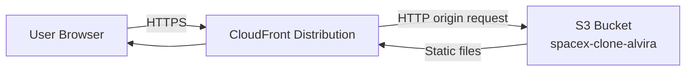
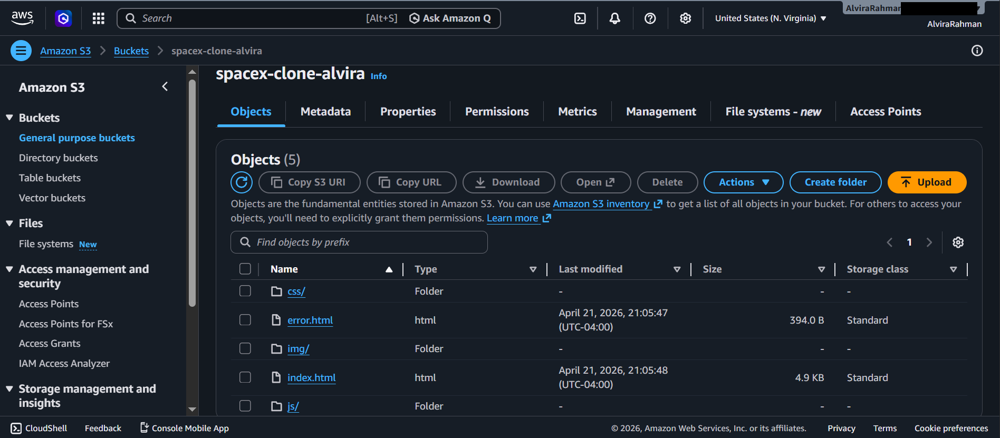
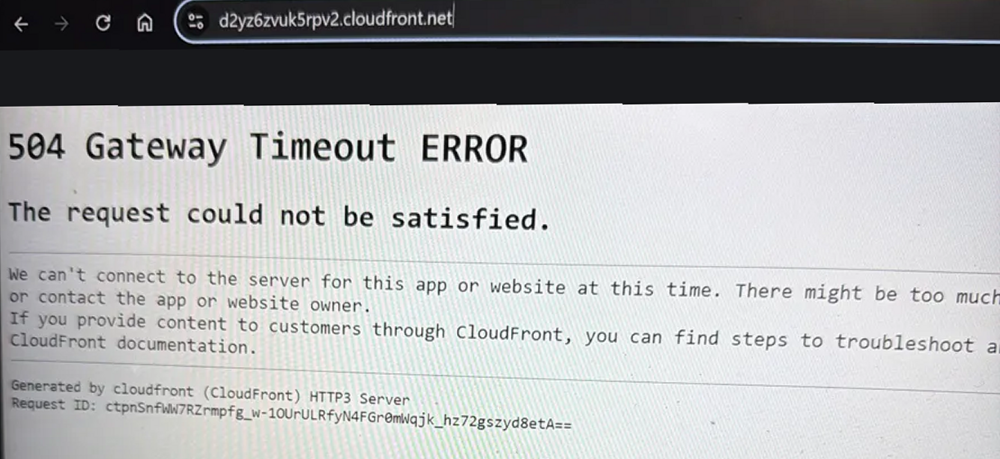
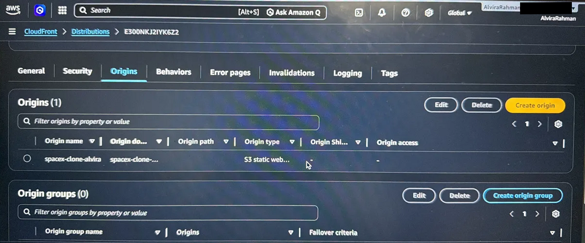
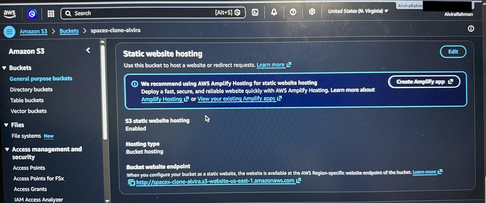
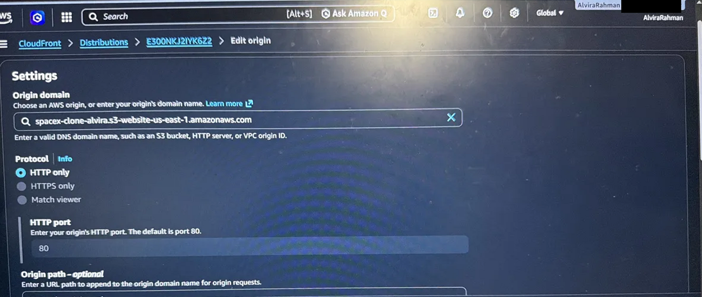
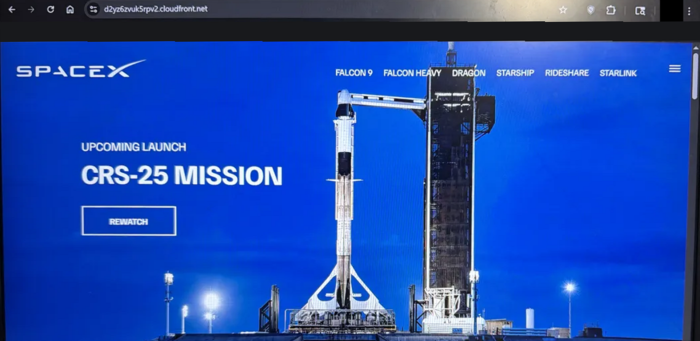
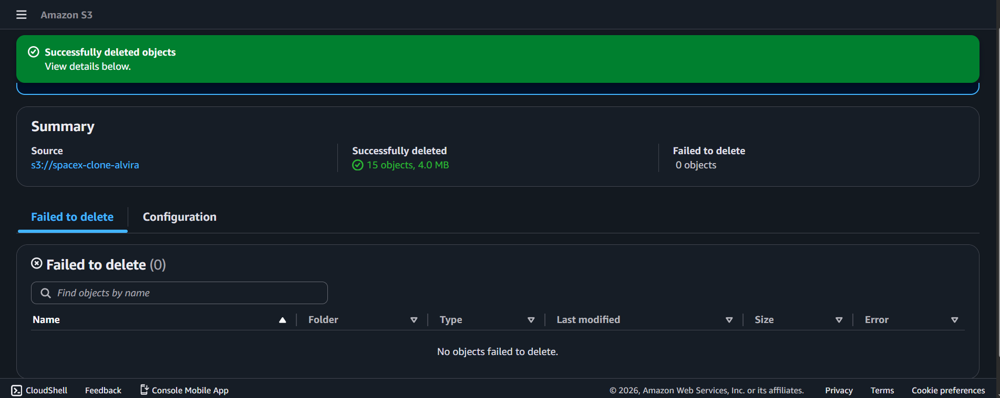
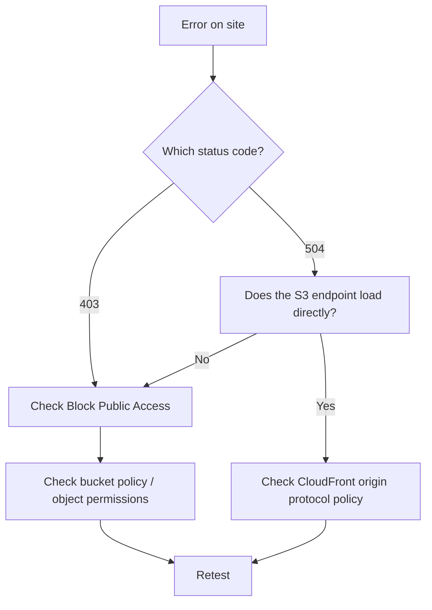

# Troubleshooting Case Study 1: Static Site on S3 + CloudFront

**Project:** SpaceX Clone static website
**Services:** Amazon S3, Amazon CloudFront, S3 Bucket Policies
**Region:** us-east-1
**Date:** April 21-22, 2026
**Author:** Alvira Rahman
**Repo:** github.com/Alvira-Rahman/spacex-clone-aws

---

## 1. Summary

| Item | Detail |
|---|---|
| Goal | Host a static website on S3 and serve it globally through CloudFront |
| Incidents | 3 (403 Forbidden, 504 Gateway Timeout, content deleted during another project's testing) |
| Root causes | Block Public Access enabled with no public policy; CloudFront origin protocol mismatch |
| Outcome | Site live and reachable through the CloudFront domain |
| Open item | Bucket uses public read instead of the Origin Access Control (OAC) pattern |

---

## 2. Architecture





**Request path:** the browser calls the CloudFront domain, CloudFront checks its cache, and on a miss it fetches the object from the S3 origin.

---

## 3. Incident 1: 403 Forbidden

### Phase 1: Detect
- **Symptom:** Requesting the site returned `403 Forbidden`.
- **Where seen:** Browser / S3 website endpoint.
- **Screenshot:** `[INSERT: 403 error page]`

### Phase 2: Investigate
| Check | Why | Finding |
|---|---|---|
| Do the files exist in the bucket? | Rule out a missing-object error | Files present |
| Bucket > Permissions > Block Public Access | S3 blocks public requests by default | Block Public Access was **ON** |
| Bucket policy | Is anything allowing `s3:GetObject`? | No public-read policy |

### Phase 3: Root cause
S3 denied anonymous reads for two stacked reasons: Block Public Access was enabled, and no bucket policy granted public `GetObject`.

### Phase 4: Fix
1. Disabled **Block Public Access** on the bucket.
2. Added a bucket policy allowing public read on objects.

```json
{
  "Version": "2012-10-17",
  "Statement": [
    {
      "Sid": "PublicReadGetObject",
      "Effect": "Allow",
      "Principal": "*",
      "Action": "s3:GetObject",
      "Resource": "arn:aws:s3:::spacex-clone-alvira/*"
    }
  ]
}
```

### Phase 5: Verify
- Reloaded the site and received `200 OK`.
- **Screenshot:** `[INSERT: working page / bucket policy]`

### Key lesson
**Order matters.** Block Public Access overrides bucket policies. It must be disabled *before* a public policy can take effect. Adding the policy first leaves the 403 in place and looks like the policy is wrong.

---

## 4. Incident 2: 504 Gateway Timeout on CloudFront

### Timeline (April 22, 2026, from the clock in each photo)

| Time | Event |
|---|---|
| Earlier | 504 error captured at the CloudFront URL |
| 9:19 PM | Checked the distribution's **Origins** tab |
| 9:20 PM | Checked the bucket's **Static website hosting** settings |
| 9:23 PM | Edited the origin protocol to **HTTP only** |
| 9:28 PM | Site loading through the CloudFront URL |

### Phase 1: Detect
- **Symptom:** The CloudFront URL (`d2yz6zvuk5rpv2.cloudfront.net`) returned `504 Gateway Timeout ERROR: The request could not be satisfied`, with the message that CloudFront could not connect to the server for the site. The footer read "Generated by cloudfront (CloudFront) HTTP3 Server" with a request ID.



### Phase 2: Investigate
| Check | Why | Finding |
|---|---|---|
| Distribution > **Origins** tab | A 504 means CloudFront could not get a response from the origin | One origin, `spacex-clone-alvira`, with origin type **S3 static website** |
| Bucket > Properties > **Static website hosting** | What does the origin actually accept? | Hosting enabled; the website endpoint is `http://spacex-clone-alvira.s3-website-us-east-1.amazonaws.com`, an **HTTP** endpoint |
| Origin protocol policy | Does it match the endpoint? | It was set to HTTPS, which the website endpoint does not serve (the root cause below) |





### Phase 3: Root cause
CloudFront was connecting to the origin over HTTPS, but the S3 website endpoint only supports HTTP. The connection failed and CloudFront returned a 504.

### Phase 4: Fix
1. Opened the distribution, then **Origins**, then edited the S3 origin.
2. Confirmed the origin domain is the website endpoint `spacex-clone-alvira.s3-website-us-east-1.amazonaws.com`.
3. Changed **Protocol** from `HTTPS only` to **`HTTP only`** (HTTP port 80).
4. Saved and waited for the distribution to deploy.



### Phase 5: Verify
- The CloudFront URL loaded the full SpaceX clone page.



### Key lesson
**The origin protocol must match the origin type.** Viewers still use HTTPS to CloudFront; only the CloudFront-to-S3 hop is HTTP for website endpoints.

---

## 4b. Incident 3: Site Content Deleted During Another Project's Testing

While testing the IAM lab (Project 2) from the **root** session, I permanently deleted all 15 objects (4.0 MB) from this bucket, taking the site offline. Root bypasses IAM policy, so nothing stopped it.



- **Recovery:** `[CONFIRM: how the site was restored]`
- **Prevention:** enable S3 versioning, keep the source in GitHub, and never test from root.
- **Full write-up:** see Case Study 2.

---

## 5. Troubleshooting Flow I Now Use



---

## 6. Security Gap and Improvement Plan

The fix for the 403 made the bucket publicly readable. That works for a demo site but is not the production best practice.

| Current state | Recommended state |
|---|---|
| Public-read bucket policy | Private bucket |
| S3 website endpoint, HTTP origin | S3 REST endpoint as origin |
| Block Public Access disabled | Block Public Access **enabled** |
| No origin authentication | **Origin Access Control (OAC)** with a policy that only allows the CloudFront distribution |

**Next step:** Rebuild the origin with OAC so only CloudFront can read the bucket, then re-enable Block Public Access and document the before/after.

---

## 7. Skills Demonstrated
- Reading HTTP status codes to isolate the failing layer (origin vs. CDN)
- S3 permissions: Block Public Access, bucket policies, `s3:GetObject`
- CloudFront origin configuration and protocol policies
- Systematic isolation: test the origin directly, then test the CDN
- Identifying and documenting a security trade-off

---

## 8. Evidence Still Needed

Provided so far: bucket contents, the full 504 incident (error, investigation, fix, working site) and the deletion screenshots. Still needed for the 403 incident (images/ folder, same naming style as your IAM repo):

| Filename | Shows |
|---|---|
| `01-s3-403-forbidden.png` | The 403 error in the browser |
| `02-block-public-access-off.png` | Block Public Access settings after the fix |
| `03-bucket-policy.png` | The bucket policy in place |

---

## 9. Before Publishing
- [ ] Replace screenshot placeholders
- [ ] Add exact error text and timestamps from your console
- [ ] Remove the AWS account ID from all screenshots and files
